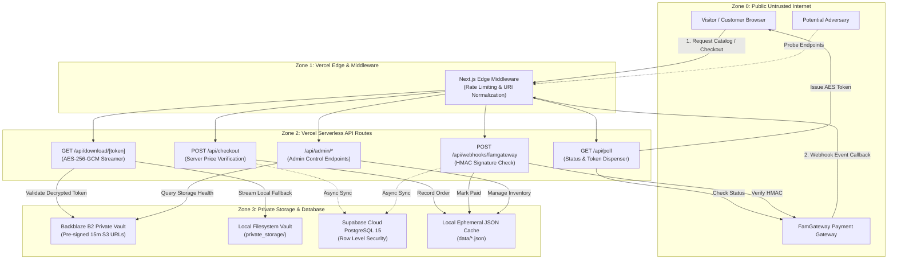

# EBOOK SHIELD 360: Comprehensive Security Audit & Threat Model Report
**Platform:** AnonTrove Ebook Commerce Platform  
**Target Application:** `projects/anon-trove-ebooks`  
**Production URL:** [https://ebook-sandy-chi.vercel.app/](https://ebook-sandy-chi.vercel.app/)  
**Primary Framework:** Next.js 14.2.18 (App Router), React 18.3.1, TypeScript 5.6.3, Tailwind CSS 3.4.15  
**Audit Standard:** OWASP Application Security Verification Standard (ASVS) 5.0.0 (Level 2), OWASP Top 10 (2021/2025)  
**Date of Audit:** November 8, 2026  
**Status:** Baseline Audit & Threat Modeling (Phases 0 & 1 Completed)

---

## 1. Executive Summary

A comprehensive architectural, cryptographic, and source-code security audit of the **AnonTrove Ebook Commerce Platform** was conducted by the autonomous security engineering team. The mission of **EBOOK SHIELD 360** is to elevate the existing platform to a production-grade, hardened, privacy-respecting, and resilient digital bookstore without discarding existing functionality or adding superfluous complexity.

The platform architecture exhibits strong design foundations in several areas:
- **Zero-Trace Privacy Architecture**: Absence of non-essential third-party tracking scripts, cookies, or user fingerprinting.
- **Timing-Safe Cryptography**: Strategic usage of `crypto.timingSafeEqual` in `lib/crypto.ts` and `lib/auth/admin.ts`.
- **Private Storage Isolation**: Delivery of paid books through time-decayed AES-256-GCM tokens and pre-signed Backblaze B2 S3 URLs, preventing raw bucket exposure.

However, the deep audit has uncovered **10 specific vulnerabilities and architectural weaknesses** spanning authorization bypass (IDOR/BOLA), insecure default secret fallbacks, sensitive token leakage in webhook responses, unauthenticated admin diagnostic endpoints, and ephemeral serverless data persistence gaps. 

---

## 2. Repository & Architectural Inventory

### 2.1 Technology Stack
- **Frontend & App Router**: Next.js 14.2.18 (`projects/anon-trove-ebooks`)
- **UI Library**: React 18.3.1, Tailwind CSS 3.4.15, Lucide React 1.16.0
- **Language / Runtime**: TypeScript 5.6.3, Node.js 20.x, Python 3.11+ (Workers & Diagnostic scripts)
- **Object Storage**: Backblaze B2 S3-Compatible API via `@aws-sdk/client-s3` (Bucket: `anontrove-private-vault`) with local fallback (`private_storage/`)
- **Payment Processing**: FamPay / FamGateway (ARYANISPE) 0.0% fee dynamic UPI (`https://famgateway.in`)
- **Database / Cloud Sync**: Supabase PostgreSQL 15 (`public.orders`, `public.books`, `public.order_items`, `public.security_audit_logs`) + local JSON cache (`data/orders_store.json`, `data/books_registry.json`)
- **Hosting / Edge**: Vercel Serverless Functions + Edge Middleware (`middleware.ts`)
- **CI/CD Automation**: GitHub Actions (`.github/workflows/security.yml`, `.github/workflows/codeql.yml`)

### 2.2 Public and Protected API Surface
| Endpoint | Method | Expected Auth | Current Auth Implementation | Vulnerability / Risk |
| :--- | :---: | :---: | :--- | :--- |
| `/api/checkout` | POST | Public | IP Rate Limit (20/min via middleware) | Price verification present; cart validation needs strict schema validation |
| `/api/poll` | GET | Public | IP Rate Limit (40/min) | **CRITICAL: IDOR / BOLA**. Token generation when order not found in local cache allows forging tokens for arbitrary books |
| `/api/download/[token]` | GET | Token | AES-256-GCM decrypt + 24h TTL + 5 download quota | Content-Type hardcoded to PDF; fallback secret key vulnerability |
| `/api/webhooks/famgateway` | POST | Webhook HMAC | `x-famgateway-signature` + fallback upstream status check | **HIGH: Token Leakage**. Replays return `issuedTokens` to unauthenticated callers |
| `/api/admin/books` | GET/PATCH | Admin Secret | `verifyAdminAccess` (`x-admin-token` / `Authorization`) | Timing-safe check in place; lacks brute-force lockout delay |
| `/api/admin/stats` | GET | Admin Secret | `verifyAdminAccess` | Timing-safe check in place |
| `/api/admin/storage/stats` | GET | Admin Secret | **MISSING (None)** | **HIGH: Authentication Bypass**. Anyone can query storage metadata & env flags |
| `/api/admin/tools` | GET/PATCH | Admin Secret | Insecure `token === secret` comparison | **HIGH: Non-timing-safe comparison** + SSRF risk in link verification |
| `/api/tools/releases` | GET | Public | Public read-only | Normal public catalog endpoint |

---

## 3. Complete Architecture Flow & Trust Boundaries

### Trust Boundary Analysis
1. **Trust Boundary 1: Client Browser -> Edge Middleware**
   - Untrusted inputs, arbitrary headers, forged IPs, high-frequency requests.
   - *Current Control*: `middleware.ts` extracts client IP via `cf-connecting-ip` / `x-forwarded-for` and applies sliding-window memory limits.
   - *Weakness*: In-memory edge maps do not sync across distinct edge locations or worker cold-starts.
2. **Trust Boundary 2: Payment Gateway Callback -> Webhook Receiver**
   - Unauthenticated network requests claiming to be payment notifications.
   - *Current Control*: Timing-safe HMAC verification via `FAMGATEWAY_API_KEY`.
   - *Critical Flaw*: If HMAC fails or is omitted, code falls back to query upstream. If upstream succeeds, the endpoint returns the customer's private download tokens directly in the HTTP response to the caller!
3. **Trust Boundary 3: Customer -> Download Streaming Route**
   - User attempting to download paid digital books.
   - *Current Control*: AES-256-GCM encrypted token with 24-hour TTL and 5-download quota.
   - *Flaw*: Uses hardcoded fallback key if `DOWNLOAD_ENCRYPTION_SECRET` is unset; download counter stored in local file which is lost on serverless redeployments.
4. **Trust Boundary 4: Browser -> Admin Dashboard**
   - Admin authentication currently uses single shared secret stored in `sessionStorage` and sent as `x-admin-token`.
   - *Flaw*: Vulnerable to token leakage if XSS occurs; no session rotation, no MFA, no administrative audit log.

---

## 4. Initial Security Scorecard

| Security Category | Baseline Score (0-100) | Status | Primary Remediation Focus |
| :--- | :---: | :---: | :--- |
| **1. Authentication & Session Security** | **55%** | Vulnerable | Implement secure admin session tokens (HTTPOnly cookies), remove sessionStorage secrets, add progressive lockout |
| **2. Authorization & Access Control** | **45%** | Critical | Fix BOLA/IDOR in `/api/poll`, eliminate unauthenticated `/api/admin/storage/stats` |
| **3. Content Protection & Storage Security** | **70%** | Needs Hardening | Eliminate hardcoded secret fallbacks, implement secure in-browser reader, validate file MIME types |
| **4. Payment Gateway & Webhook Security** | **60%** | High Risk | Fix webhook token leakage, enforce database idempotency constraints, eliminate public QR generation service |
| **5. Database & Row-Level Security** | **65%** | Incomplete | Persist itemized entitlements to Supabase, enforce strict RLS policies, eliminate silent sync drops |
| **6. Frontend & API Security** | **70%** | Moderate | Tighten CSP (remove `unsafe-eval`), add strict schema validation (Zod) on all API inputs |
| **7. CI/CD & Supply Chain Security** | **65%** | Needs Hardening | Pin GitHub Actions to commit SHAs, integrate actionlint, Gitleaks, Semgrep, and Scorecard |
| **8. Observability & Incident Response** | **40%** | Poor | Build structured security event logger, create `SECURITY_INCIDENT_RESPONSE.md` runbook |
| **OVERALL INITIAL SECURITY SCORE** | **58.75%** | **ACTION REQUIRED** | Transform through Phase 2 to Phase 12 systematic engineering |

---

## 5. Next Steps
- Transition immediately to **PHASE 2**: Full vulnerability baseline, official GitHub security scanner integration, and automated regression test suite formulation.
