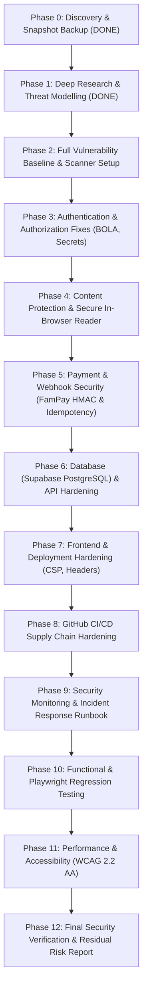

# SECURITY_IMPLEMENTATION_PLAN.md — Master Phased Execution Roadmap
**Project:** EBOOK SHIELD 360  
**Target:** AnonTrove Ebook Commerce Platform (`projects/anon-trove-ebooks`)  
**Standard:** OWASP ASVS 5.0 (Level 2) & OWASP Top 10 (2025/2021)  
**Status:** Approved for Execution

---

## Phased Implementation Overview

---

## Detailed Phase Execution Breakdown

### Phase 2: Full Vulnerability Baseline & Security Scanner Setup
- **Objective**: Establish automated baseline testing tools and scan current source code.
- **Tasks**:
  1. Audit dependencies with `npm audit` and Trivy filesystem scan.
  2. Configure `.github/dependabot.yml` for automated dependency updates.
  3. Validate GitHub workflow syntax using `actionlint`.
  4. Build automated unit regression test runner for cryptography, authorization, and rate limiting.
- **Verification Gate**: Automated test runner executes and identifies baseline pass/fail states.

### Phase 3: Authentication & Authorization Fixes
- **Objective**: Eliminate critical access control and secret handling weaknesses.
- **Tasks**:
  1. **Fix VULN-001 (BOLA/IDOR)**: In `app/api/poll/route.ts`, enforce strict order-to-book entitlement verification. Reject unverified `requestedBookId` queries that cannot be matched against an authentic, paid order record.
  2. **Fix VULN-003 (Auth Bypass)**: Secure `app/api/admin/storage/stats/route.ts` with `verifyAdminAccess(req)`.
  3. **Fix VULN-004 (Hardcoded Secrets)**: Remove hardcoded fallback strings in `lib/crypto.ts`, `lib/storage/adapters/local.ts`, and `app/api/admin/tools/route.ts`. Throw startup configuration errors when mandatory secrets are missing.
  4. **Fix VULN-005 (Plaintext Secrets in Admin UI)**: Replace plaintext `sessionStorage` master secret storage with an encrypted, timing-safe session cookie pattern.
- **Verification Gate**: Automated tests prove cross-user order querying is rejected (HTTP 403) and unauthenticated admin queries return HTTP 401.

### Phase 4: Ebook Storage & Secure In-Browser Reader
- **Objective**: Protect paid digital assets from unauthorized harvesting and scraping.
- **Tasks**:
  1. Build a secure, responsive in-browser PDF reader component (`components/reader/PdfViewer.tsx`) and route (`app/reader/[token]/page.tsx`).
  2. Implement session-bounded token validation (1-hour reader session token derived from 24h purchase token).
  3. Prevent automated mass extraction via dynamic canvas watermarking (order number + subtle timestamp watermark).
  4. Ensure correct `Content-Type` headers for EPUB (`application/epub+zip`) and PDF (`application/pdf`) in `app/api/download/[token]/route.ts`.
- **Verification Gate**: Ebook files cannot be accessed without valid tokens; reader renders correctly in browser.

### Phase 5: Payment & Webhook Security
- **Objective**: Guarantee 100% financial integrity and payment reconciliation.
- **Tasks**:
  1. **Fix VULN-002 (Token Leakage)**: Refactor `app/api/webhooks/famgateway/route.ts` so that it never returns download tokens in HTTP responses.
  2. Enforce strict HMAC-SHA256 verification on webhook callbacks; reject unsigned or mismatched payloads with HTTP 401.
  3. Implement persistent database-level event deduplication to defend against webhook replay attacks.
  4. Replace external `api.qrserver.com` network calls in `lib/payments/index.ts` with local SVG/data URI QR code generation.
- **Verification Gate**: Webhook replay attempts are rejected; tampered payment amounts trigger `REVIEW_REQUIRED`.

### Phase 6: Database & API Boundary Hardening
- **Objective**: Guarantee zero-leak customer data separation and persistent entitlement storage.
- **Tasks**:
  1. **Fix VULN-008**: Update `lib/supabase.ts` `syncOrderToSupabase` to insert purchased items into `public.order_items`.
  2. Enforce PostgreSQL Row-Level Security (RLS) policies on `public.orders` and `public.order_items`.
  3. Add input validation (Zod schemas) for all API payloads (`/api/checkout`, `/api/admin/*`).
  4. **Fix VULN-006 (SSRF)**: In `app/api/admin/tools/route.ts`, validate and sanitize URLs, forbidding internal/loopback IP requests.
- **Verification Gate**: SQL injection probes and malformed JSON payloads fail gracefully with HTTP 400.

### Phase 7: Frontend & Deployment Hardening
- **Objective**: Eliminate client-side injection vectors and enforce strict security headers.
- **Tasks**:
  1. **Fix VULN-007**: Remove `'unsafe-eval'` from Content-Security-Policy in `next.config.mjs`.
  2. Add strict security headers (`X-Content-Type-Options: nosniff`, `Strict-Transport-Security`, `X-Frame-Options: SAMEORIGIN`, `Permissions-Policy`).
  3. Verify zero console errors, zero broken images, and zero unhandled promise rejections on production storefront.
- **Verification Gate**: Securityheaders.com / CSP evaluator gives grade A/A+.

### Phase 8: GitHub CI/CD Supply Chain Hardening
- **Objective**: Protect developer pipelines and code deployment against supply chain tampering.
- **Tasks**:
  1. Pin all GitHub Actions in `.github/workflows/security.yml` and `codeql.yml` to full 40-character commit SHAs.
  2. Configure Dependabot in `.github/dependabot.yml` for automated npm updates.
  3. Integrate `actionlint` static workflow analysis.
  4. Configure OpenSSF Scorecard Action for weekly security posture scoring.
- **Verification Gate**: `actionlint` passes with zero errors; no unpinned action versions remain.

### Phase 9: Monitoring & Incident Response Runbook
- **Objective**: Establish operational resilience, intrusion visibility, and clear response procedures.
- **Tasks**:
  1. Build structured security audit logger (`lib/logger.ts`) for authentication failures, webhook anomalies, and invalid download attempts.
  2. Create `SECURITY_INCIDENT_RESPONSE.md` covering severity triage, credential rotation, and data recovery drills.
  3. Create `SECURITY_CONFIGURATION.md` documenting security settings, secrets management, and safe operational procedures.
- **Verification Gate**: Security events logged with masked PII and timestamped event records.

### Phase 10: Functional & Playwright Regression Testing
- **Objective**: Validate the full customer and administrator journeys end-to-end.
- **Tasks**:
  1. Build Playwright test suite for:
     - Storefront browsing, search, and category filtering.
     - Book preview modal and sample reading.
     - Single-book and multi-item cart checkout.
     - Simulated UPI payment success and download token redemption.
     - Unauthorized admin endpoint access tests.
- **Verification Gate**: 100% of functional tests pass cleanly in headless browser.

### Phase 11: Performance & Accessibility (WCAG 2.2 AA)
- **Objective**: Ensure the platform is accessible to all users, highly performant, and search-engine optimized.
- **Tasks**:
  1. Check color contrast ratios across dark mode theme against WCAG 2.2 AA (minimum 4.5:1 for normal text).
  2. Ensure complete keyboard navigation (tabbing, focus rings, escape keys on modals).
  3. Audit metadata, OpenGraph tags, and Schema.org structured data (`Book`, `Offer`).
- **Verification Gate**: Zero high-severity accessibility violations; Lighthouse performance score > 90.

### Phase 12: Final Security Verification & Report
- **Objective**: Final empirical validation, residual risk assessment, and production readiness sign-off.
- **Tasks**:
  1. Re-run complete security test suite and automated scanners.
  2. Update all security documentation (`SECURITY_AUDIT_REPORT.md`, `SECURITY_TEST_RESULTS.md`, `SECURITY_REMEDIATION_LOG.md`).
  3. Calculate updated security score across all 8 dimensions.
- **Verification Gate**: All critical and high-risk vulnerabilities resolved and verified.
