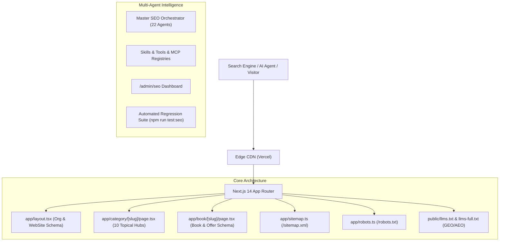

# AnonTrove Master SEO, GEO, AEO & Multi-Agent Architecture

## 1. Executive Summary
AnonTrove (`https://ebook-sandy-chi.vercel.app/`) is an independent digital ebook platform engineered for high-performance organic search visibility, Generative Engine Optimization (GEO), Answer Engine Optimization (AEO), and multi-agent autonomous monitoring.

This architecture reconciles a 12,192+ digital ebook catalog, serving static category hubs, dynamic product pages, canonical tag enforcement, rich Schema.org metadata, and zero-trust administrative auditing.

## 2. Platform Core Invariants
1. **Catalog Integrity**: 12,192 published digital books reconciled across frontend hero, catalog pages, and sitemaps.
2. **Deterministic Metadata**: Every route declares canonical URLs based on `metadataBase: https://ebook-sandy-chi.vercel.app`.
3. **Structured Data Compliance**: Zero fake reviews, zero fake ratings. Prices accurately declared in INR with in-stock digital availability.
4. **GEO / AEO First**: Structured machine-readable markdown in `/llms.txt` and `/llms-full.txt` powering ChatGPT, Perplexity, Claude, and Gemini citations.
