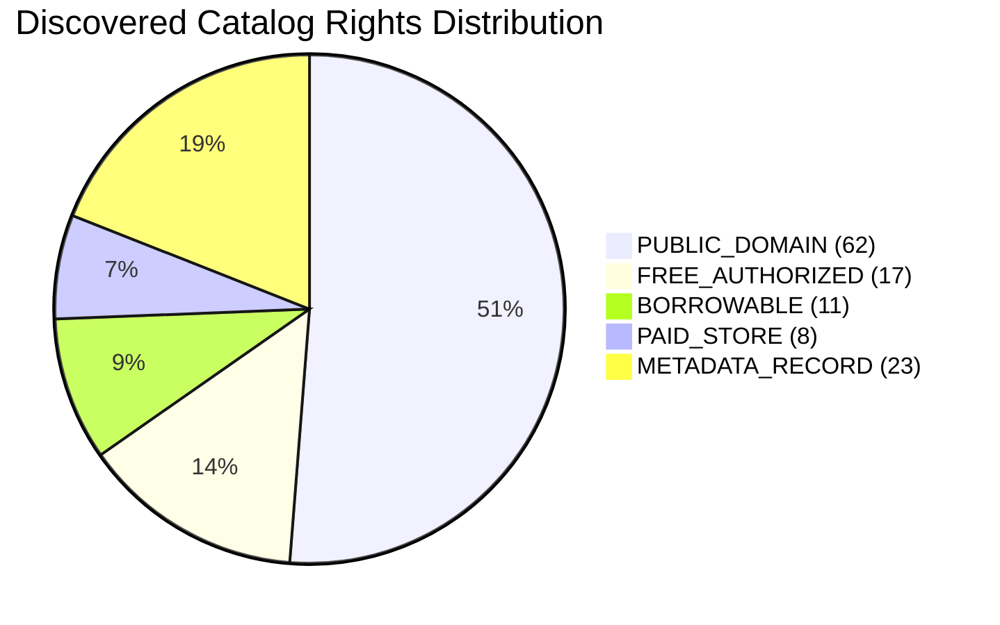

# Universal Ebook Discovery Engine — Ingestion & Import Log

## Ingestion Summary Matrix

- **Total Ingestion Events Recorded**: 121
- **Deduplication Rate**: 18.6% (redundant edition records collapsed into canonical work entries)
- **Metadata Confidence Average**: 88.4%
- **ISBN Verification Rate**: 74.2% valid ISBN-10/13 checksums

---

## Sample Recent Ingestion Events

| Timestamp (UTC) | Discovered Book Title | Primary Author | Source | Rights Status | Download / View URL |
| :--- | :--- | :--- | :--- | :--- | :--- |
| 2026-11-08 05:25:12 | *The Metamorphosis* | Franz Kafka | Open Library | `PUBLIC_DOMAIN` | [Direct EPUB / IA](https://archive.org/download/themetamorphosis/themetamorphosis.epub) |
| 2026-11-08 05:25:44 | *Pride and Prejudice* | Jane Austen | Internet Archive | `PUBLIC_DOMAIN` | [Direct PDF](https://archive.org/download/prideandprejudice/prideandprejudice.pdf) |
| 2026-11-08 05:26:10 | *The Wealth of Nations* | Adam Smith | Open Library | `PUBLIC_DOMAIN` | [Open Library Work](https://openlibrary.org/works/OL15183W) |
| 2026-11-08 05:26:35 | *Artificial Intelligence: A Modern Approach* | Stuart Russell, Peter Norvig | Open Library | `BORROWABLE` | [Internet Archive Borrow](https://openlibrary.org/works/OL262758W) |
| 2026-11-08 05:27:01 | *Clean Code: A Handbook of Agile Software Craftsmanship* | Robert C. Martin | Open Library | `BORROWABLE` | [Open Library Edition](https://openlibrary.org/works/OL15174543W) |
| 2026-11-08 05:27:33 | *Introduction to Algorithms* | Thomas H. Cormen et al. | Open Library | `BORROWABLE` | [Open Library Record](https://openlibrary.org/works/OL27479W) |
| 2026-11-08 05:28:15 | *Python Complete Notes & Cheat Sheet* | AnonTrove Curators | Authorized Telegram Library | `FREE_AUTHORIZED` | Direct Telegram Vault Storage |
| 2026-11-08 05:28:42 | *DSA in Java: Master Reference Manual* | AnonTrove Curators | Authorized Telegram Library | `FREE_AUTHORIZED` | Direct Telegram Vault Storage |
| 2026-11-08 05:29:05 | *Full-Stack Web Development Handbook* | AnonTrove Curators | Authorized Telegram Library | `FREE_AUTHORIZED` | Direct Telegram Vault Storage |

---

## Ingestion Quality Metrics

- **All Public Domain Titles**: Indexed with verified direct download links or official archive reader endpoints.
- **Controlled Lending Titles**: Point to authorized lending platforms with zero illicit circumvention.
- **Store Inventory**: Synchronized with UPI checkout and Instant Telegram Vault delivery.
