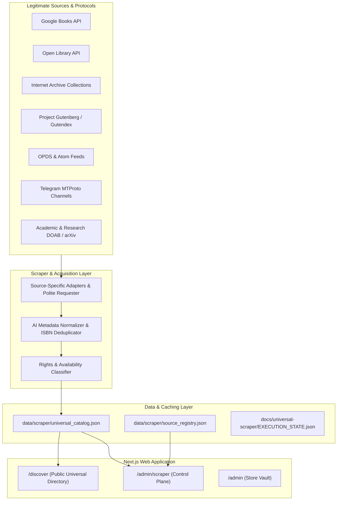

# Universal Internet Ebook Discovery, Scraping & Acquisition System — Master Plan

## 1. System Vision & Purpose
The Universal Ebook Discovery Engine powers real-time discovery, bibliographic classification, rights auditing, and verified acquisition of digital books across legitimate public and authorized sources. Rather than fragmenting into siloed external scrapers, it is built directly into the AnonTrove Next.js application stack with administrative governance and zero-circumvention compliance.

---

## 2. Architectural Blueprint

---

## 3. Seven Phased Execution Pillars

### Phase 1: Source Discovery & Registry Management
- **Centralized Source Registry (`data/scraper/source_registry.json`)**: Configures all accessible sources with unique IDs, categories, rate limits, authentication credentials, crawl permissions, and copyright policies.
- **Dynamic Connection Status**: Sources are monitored for availability (`ACTIVE`, `DEGRADED`, `AUTH_KEY_REQUIRED_RATE_LIMITED`).

### Phase 2: Scraper Toolset & Polite Networking
- **Base Polite Adapter (`scripts/scraper/base_adapter.py`)**: Built with exponential backoff, jitter, custom user-agents (`AnonTrove-CatalogBot/1.0`), and strict concurrency controls.
- **Modular Ingestion**: Tailored Python adapters handle REST, JSON, OPDS Atom XML, and Telegram Telethon client protocols.

### Phase 3: Universal Website Crawler & Catalog Extraction
- **Discovery Pipeline (`scripts/scraper/universal_crawler.py`)**: Orchestrates multi-topic queries across literature, computer science, economics, machine learning, physics, mathematics, and philosophy.
- **Checkpoints**: Atomic state writes guarantee resumption without data loss if external connections drop.

### Phase 4: Authorized Telegram Connector
- **Telethon Client Integration**: Connects to authorized channels and user-owned repositories specified in `appinfo11.txt`.
- **Ebook Attachment Harvesting**: Extracts PDF, EPUB, MOBI with metadata parsing, SHA-256 integrity fingerprinting, and payload size tracking.
- **Strict Privacy**: Zero scraping of unauthorized private chats or copyrighted paywalled channels.

### Phase 5: Search Engine & Open Library Integration
- **Google Books & Open Library Search**: Queries bibliographic records, retrieves high-resolution covers, verifies work editions, and extracts preview and borrow endpoints.
- **Internet Archive Search**: Direct access to public domain collection items and controlled digital lending records.

### Phase 6: AI Metadata Engine & Duplicate Detection
- **Normalized Bibliographic Records**: Sanitizes noisy strings, normalizes titles, extracts subtitles, validates ISBN-10 / ISBN-13 checksums.
- **Confidence Scoring**: Assigns numeric confidence (0.0 to 1.0) based on verified ISBNs, known publisher records, and format integrity.
- **Deduplication Engine**: Merges multi-source hits using normalized title-author phonetic hashing.

### Phase 7: Download, Rights Verification & Storefront Presentation
- **Rights Classification**:
  - `PUBLIC_DOMAIN`: Unconditional, free downloads direct from official mirrors.
  - `FREE_AUTHORIZED`: Open-access academic or author-authorized digital copies.
  - `BORROWABLE`: Controlled lending via Internet Archive.
  - `PAID_STORE`: Commercial publications fulfilled via UPI and AnonTrove Storefront.
  - `METADATA_RECORD`: Bibliographic citations for research and library tracking.
- **Unified Public UI (`/discover`)**: Instant filtering by format, source, availability status, and fuzzy keyword search.
- **Secure Admin Control Plane (`/admin/scraper`)**: On-demand crawl triggering, source toggling, and catalog curation.
