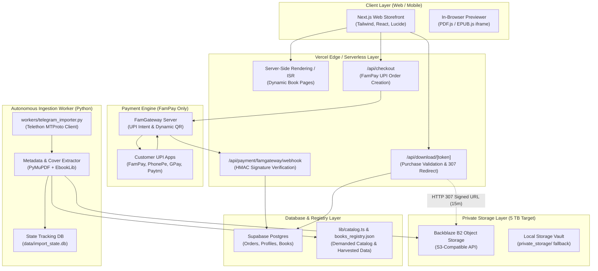

# AnonTrove — System Architecture & Data Flow

## 1. High-Level Architecture Overview

AnonTrove is designed as a hybrid decoupled system balancing zero-cold-start serverless delivery on Vercel with autonomous background data processing:

---

## 2. Component Breakdown

### A. Next.js Frontend & API (Vercel)
- **Framework:** Next.js 14+ (App Router), React 18, TypeScript, Tailwind CSS.
- **Rendering Strategy:** 
  - Top 150 bestseller & demanded books pre-rendered statically (`generateStaticParams`).
  - Remaining 12,000+ catalog titles rendered on-demand with ISR caching (`dynamicParams = true`).
  - Clean separation: No multi-megabyte PDF binaries ever touch the Next.js runtime bundle or serverless memory.

### B. Payment Engine (FamPay API Only)
- **Merchant ID:** `wowtarik@yesfam` (FamGateway).
- **Security:** 
  - Server-side signature validation on incoming webhooks using HMAC-SHA256 with the secret stored in environment variables (`appinfo11.txt`).
  - Zero-mocking in production: All transactions route directly to the active FamGateway instance.
  - Cart total and prices are cryptographically sealed and cross-checked against server-side catalog definitions to prevent price manipulation.

### C. Storage Abstraction Layer (`lib/storage`)
- **Interface:** `IStorageAdapter` defining standard object storage operations: upload, multipart upload, pre-signed download URL generation, deletion, checksum verification, and storage quota monitoring.
- **Implementations:**
  - `BackblazeB2Adapter`: Primary production storage target (5 TB capacity at ~$0.006/GB/mo = ~$30/mo, zero egress fees via Cloudflare Bandwidth Alliance or standard S3 pricing).
  - `LocalStorageAdapter`: Development and local VPS fallback targeting `./private_storage`.
  - Future-proof: Easily swappable to Cloudflare R2, AWS S3, or Wasabi without changing route handlers.

### D. Zero-Proxy Download & Streaming (`/api/download/[token]`)
- **Vercel Serverless Protection:** Vercel functions have strict execution time limits (10s–60s) and payload limits (4.5 MB response). Streaming 50 MB to 500 MB books through serverless functions exhausts memory and causes timeouts.
- **Direct S3 Pre-Signed Redirect (HTTP 307):**
  1. Customer requests `/api/download/{token}`.
  2. Server verifies the cryptographically signed JWT token (checks order ID, expiration, book ID, customer email).
  3. Server logs the download audit event (`download_events` table).
  4. Server calls `b2Adapter.getSignedUrl(storageKey, 900, bookFilename)` (valid for 15 minutes only).
  5. Server returns `HTTP 307 Temporary Redirect` to the signed B2 URL with `Content-Disposition: attachment; filename="<title>.<ext>"`.
  6. The client browser downloads directly from Backblaze B2's high-speed CDN edge.

### E. Telegram Ingestion Worker (`workers/telegram_importer.py`)
- **Runtime:** Persistent Python process running on a dedicated worker machine or VPS (never on Vercel serverless).
- **Capabilities:**
  - Connects to Telegram MTProto via Telethon using API ID, Hash, and Session stored in `appinfo11.txt`.
  - Monitors authorized private channels and groups.
  - Automatically filters messages for `.pdf`, `.epub`, `.mobi`, `.cbz`, `.docx`.
  - Performs SHA-256 deduplication against existing library registry.
  - Extracts cover art using PyMuPDF (PDF page 0 rendering at 300 DPI) or EbookLib (EPUB manifest cover image extraction).
  - Uploads the validated file directly into the target Backblaze B2 bucket under structured prefixes: `storage/v1/{format}/{category}/{hash}.{format}`.
  - Updates local SQLite state `data/import_state.db` and exports enriched metadata to `data/books_registry.json`.
