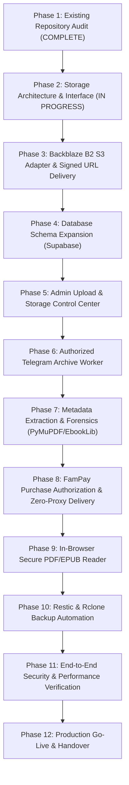

# IMPLEMENTATION MASTER PLAN
## Secure Ebook Storage, Telegram Archive Import & Website Delivery

**Project:** AnonTrove Ebook Commerce Platform  
**Target Environment:** Vercel (Frontend & Web API) + Autonomous Worker (Storage & Ingestion)  
**Storage Target:** 5 TB Private Object Storage (Backblaze B2 S3-Compatible API)  
**Exclusive Payment Gateway:** FamPay UPI (ARYANISPE / FamGateway)  
**Database:** Supabase PostgreSQL 15 + Local Resilient Cache  
**Date Created:** November 8, 2026  
**Status:** In Progress (Phase 1 Complete - Architecture Audit & Master Design)

---

## 1. Executive Summary & Cost Estimation (5 TB Target)

### Monthly Cost Projection
| Infrastructure Component | Provider / Tool | Spec / Volume | Estimated Monthly Cost | Approval Status |
| :--- | :--- | :--- | :--- | :--- |
| **Primary Object Storage** | Backblaze B2 | 5 TB ($0.006/GB/mo) | **$30.00 / mo** (~₹2,550) | Pending User Approval |
| **Storage Egress** | Backblaze B2 (first 3x free, then $0.01/GB) | 1 TB/mo download bandwidth | **$0.00** (Included in free allowance) | Approved (Free tier) |
| **Payment Gateway** | FamPay (FamGateway) | Unlimited UPI transactions | **₹0.00** (0% transaction fee) | Active & Configured |
| **Serverless Hosting** | Vercel Hobby / Pro | Edge network, SSR, Serverless API | **$0.00** (Hobby) / $20 (Pro) | Active |
| **Database & Auth** | Supabase Cloud | 500 MB DB, Auth, RLS | **$0.00** (Free Tier) | Configured |
| **Worker Environment** | Local Host / VPS (e.g. Hetzner/Railway) | 2 vCPU, 4GB RAM for Telegram & OCR | **$0.00** (Local Worker) / $5.00 (VPS) | Local Default (Zero Cost) |
| **Encrypted Backups** | Restic + B2 Cloud / Cold Storage | 50 GB critical metadata & catalogs | **$0.30 / mo** (~₹25) | Planned |
| **TOTAL EXPECTED** | | **5 TB Storage + Streaming Delivery** | **~$30.00 / month (~₹2,550)** | **Awaiting Approval** |

> [!IMPORTANT]
> No paid subscriptions or infrastructure will be purchased without explicit approval. All initial phases operate using local sandbox storage adapters and local worker pipelines at ₹0 additional cost.

---

## 2. Phased Implementation Roadmap

### Phase 1: Existing Repository Audit & Baseline Verification (Completed)
- [x] Full source code inspection of `projects/anon-trove-ebooks`.
- [x] Verification of exclusive FamPay UPI payment rail.
- [x] Verification of 300 curated demanded titles with verified cover thumbnails.
- [x] Fix of SSR HTTP 500 error and 404 cover thumbnails on Vercel live production.
- [x] Discovery of installed python dependencies: `Telethon`, `EbookLib`, `famgateway`, `cryptography`, `SQLAlchemy`.

### Phase 2: Storage Architecture & Provider Abstraction
- [ ] Implement `IStorageAdapter` contract in TypeScript (`lib/storage/types.ts`).
- [ ] Define uniform methods: `upload`, `multipartUpload`, `download`, `getSignedUrl`, `delete`, `copy`, `move`, `getMetadata`, `getChecksum`, `testConnection`, `getStorageUsage`.
- [ ] Build local filesystem storage adapter (`lib/storage/adapters/local.ts`) preserving compatibility with `private_storage/`.

### Phase 3: Backblaze B2 S3-Compatible Adapter
- [ ] Implement `BackblazeB2StorageAdapter` using native AWS S3 SDK v3 protocol (`@aws-sdk/client-s3`).
- [ ] Support private buckets with zero public ACLs.
- [ ] Add pre-signed GET URL generator with configurable expiration (default 15 minutes / 900s).
- [ ] Implement chunked multipart upload for multi-hundred-megabyte files.
- [ ] Implement SHA-256 cryptographic checksum calculation and validation.
- [ ] Add adapter factory (`lib/storage/index.ts`) supporting hot-swapping between `LOCAL`, `BACKBLAZE_B2`, and `CLOUDFLARE_R2`.

### Phase 4: Database Schema Migration (Supabase PostgreSQL 15)
- [ ] Design non-destructive SQL migration script for new storage and archive entities:
  - `storage_providers`, `storage_objects`, `ebooks`, `ebook_files`, `ebook_covers`, `ebook_rights`, `import_sources`, `import_jobs`, `import_items`, `purchases`, `ebook_access`, `download_events`, `backup_jobs`, `storage_health`.
- [ ] Maintain 100% backward compatibility with existing `orders` and `user_library` tables.
- [ ] Apply Row-Level Security (RLS) policies for tenant and purchase isolation.

### Phase 5: Admin Upload & Storage Dashboard
- [ ] Build administrative UI at `/admin/storage` displaying storage usage, total objects, duplicate count, and health status.
- [ ] Implement client-side direct-to-storage multipart uploader (resumable, chunked) using pre-signed upload URLs to bypass Vercel payload limits.
- [ ] Enforce administrator authentication on all mutation routes.

### Phase 6: Authorized Telegram Archive Importer
- [ ] Build an autonomous Python worker (`workers/telegram_importer.py`) utilizing `Telethon`.
- [ ] Implement source authorization checking (whitelisted channel and group IDs only).
- [ ] Implement message stream traversal with format filtering (`.pdf`, `.epub`, `.mobi`, `.azw3`).
- [ ] Implement SQLite-backed checkpoint state machine to survive script termination, computer shutdown, or API rate limits.
- [ ] Implement flood-wait auto-backoff respecting Telegram API limits.
- [ ] Ingest discovered documents into private storage with SHA-256 duplicate rejection.

### Phase 7: Metadata Extraction & Deduplication Engine
- [ ] Build metadata extractor using `pypdf`, `pymupdf` (fitz), and `EbookLib`.
- [ ] Extract page count, title, author, publication year, ISBN, and genuine front-cover thumbnail.
- [ ] Deduplicate based on exact SHA-256 hash, ISBN, and normalized title+author vectors.
- [ ] Quarantine suspicious or corrupt files without deleting original archives.

### Phase 8: FamPay Purchase Authorization & Zero-Proxy Delivery
- [ ] Refactor `app/api/download/[token]/route.ts`:
  - Verify purchase token via AES-256-GCM.
  - Enforce max download count (default 5) and 24h TTL.
  - Generate a 15-minute pre-signed Backblaze B2 download URL.
  - Issue 307 Temporary Redirect to the pre-signed URL so Vercel never streams gigabytes of file payloads through serverless lambdas.
- [ ] Log download audit events with masked IP and timestamp.

### Phase 9: Secure In-Browser Ebook Reader
- [ ] Integrate stream-based reader using short-lived signed token.
- [ ] Support PDF via PDF.js worker and EPUB via EPUB.js.
- [ ] Track reading position and bookmark synchronization to Supabase `user_library`.

### Phase 10: Encrypted Backups & Disaster Recovery
- [ ] Set up Restic backup automation for database schemas, configuration, and catalog registries.
- [ ] Configure rclone synchronization script for off-site bucket replication.
- [ ] Write disaster recovery drill procedure and step-by-step restoration script.

### Phase 11: Security Audit & Automated Testing
- [ ] Unit tests for storage adapter interface.
- [ ] Integration tests for signed URL generation and expiration.
- [ ] Webhook signature spoofing test for FamPay.
- [ ] Authorization tests verifying customer purchase isolation.
- [ ] Semgrep static analysis scan.

### Phase 12: Production Go-Live & Resumable Checkpoint Documentation
- [ ] Production deployment to Vercel.
- [ ] Verify live site health and performance.
- [ ] Finalize operational runbooks and handoff documentation.
