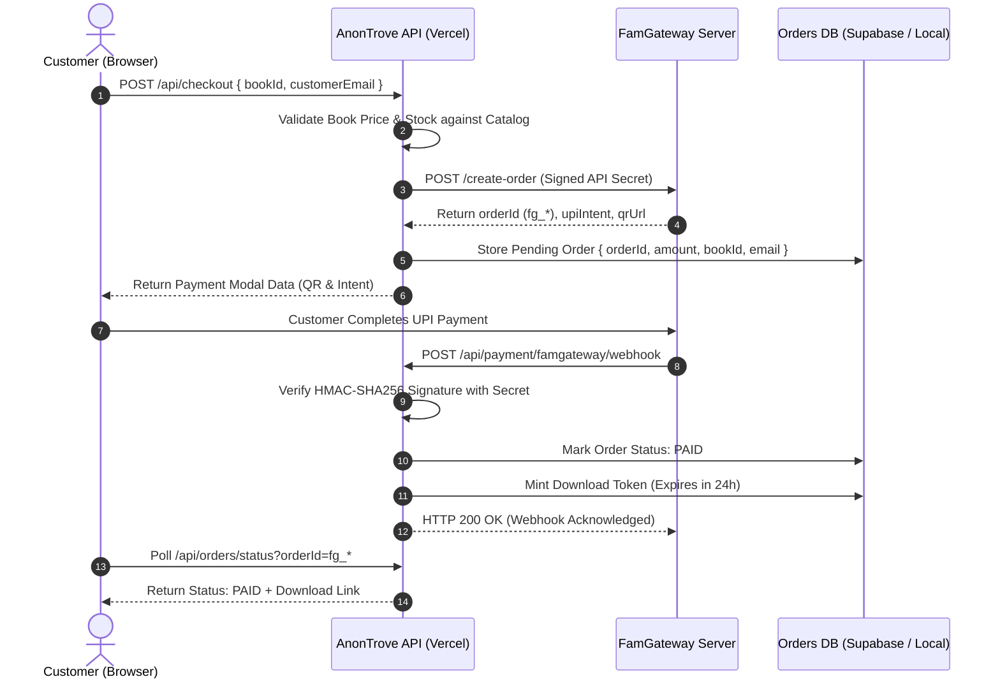

# AnonTrove — Security & Privacy Architecture

## 1. Zero-Trust Security Guiding Principles

AnonTrove handles digital intellectual property, payment workflows, and user identities. The platform adheres to strict zero-trust standards:

1. **Credential Hygiene:** Never commit secrets, API keys, private tokens, or customer PII to source repositories or public client bundles.
2. **Payment Exclusivity:** FamPay UPI (`famgateway.in`) is the sole authorized payment channel. All legacy gateways (Razorpay, Cashfree, PayGic) are completely removed from CSP and code execution.
3. **Signed Token Delivery:** Direct file access is never public. Every download requires a time-delimited cryptographically signed token verified server-side.
4. **Strict CSP & Origin Isolation:** Edge security headers block untrusted scripts, clickjacking, and unauthorized API connections.

---

## 2. Payment Security Protocol (FamPay UPI Only)



### Critical Payment Guardrails:
- **Price Tampering Defense:** Prices submitted from the frontend are strictly ignored. The server pulls canonical pricing directly from `lib/catalog.ts`.
- **Idempotent Webhooks:** Webhook processing checks if an order is already marked `PAID`. Duplicate notifications do not trigger duplicate fulfillment or token minting.
- **HMAC Verification:** Any webhook payload with an invalid or missing signature is rejected with `HTTP 401 Unauthorized` and flagged for security auditing.

---

## 3. Storage & Download Security

### Pre-Signed URL Architecture:
- Ebook files in Backblaze B2 are stored in a **Private Bucket** (`allPrivate: true`).
- Anonymous public HTTP access to the bucket is blocked at the bucket policy level.
- The Vercel API generates temporary AWS S3 v4 pre-signed URLs with a **15-minute maximum TTL**.
- Signed URLs include strict `response-content-disposition` headers locking the filename and preventing in-browser inline execution of arbitrary binary files.

### Token Specifications:
- Download tokens are minted using AES-256-GCM encryption or HMAC-SHA256 signed JWTs.
- Token claims:
  - `sub`: User ID or verified email
  - `orderId`: FamPay order identifier (`fg_*`)
  - `bookId`: Authorized ebook SKU
  - `iat`: Issue timestamp
  - `exp`: Expiration timestamp (maximum 24 hours)
  - `nonce`: Cryptographic random string preventing replay attacks

---

## 4. Telegram Worker & Credential Security

- **Isolation:** The Telegram ingestion worker (`workers/telegram_importer.py`) runs in a sandboxed background environment.
- **No Token Exposure:** The MTProto credentials (`TELEGRAM_API_ID`, `TELEGRAM_API_HASH`, session strings) are stored in `appinfo11.txt` and `.env.local`. They are never passed to client applications or logged in stdout.
- **Channel Whitelisting:** The importer only listens to explicitly configured channel IDs. Any message from non-whitelisted entities is discarded immediately.
- **Malware & MIME Verification:**
  - Validates file signatures (magic bytes) to ensure a `.pdf` is actually a valid PDF (`%PDF-`), not an executable disguised with a `.pdf` extension.
  - Prohibits dangerous extensions: `.exe`, `.bat`, `.cmd`, `.ps1`, `.vbs`, `.js`, `.scr`, `.pif`.

---

## 5. Security Headers & CSP Configuration

The application enforces the following production security headers in `next.config.mjs`:

```javascript
{
  key: 'Content-Security-Policy',
  value: [
    "default-src 'self'",
    "script-src 'self' 'unsafe-eval' 'unsafe-inline' https://cdn.jsdelivr.net",
    "style-src 'self' 'unsafe-inline' https://fonts.googleapis.com",
    "img-src 'self' data: blob: https://famgateway.in https://*.supabase.co https://*.backblazeb2.com",
    "connect-src 'self' https://famgateway.in https://*.supabase.co https://*.backblazeb2.com",
    "frame-ancestors 'none'",
    "object-src 'none'",
    "base-uri 'self'"
  ].join('; ')
}
```
