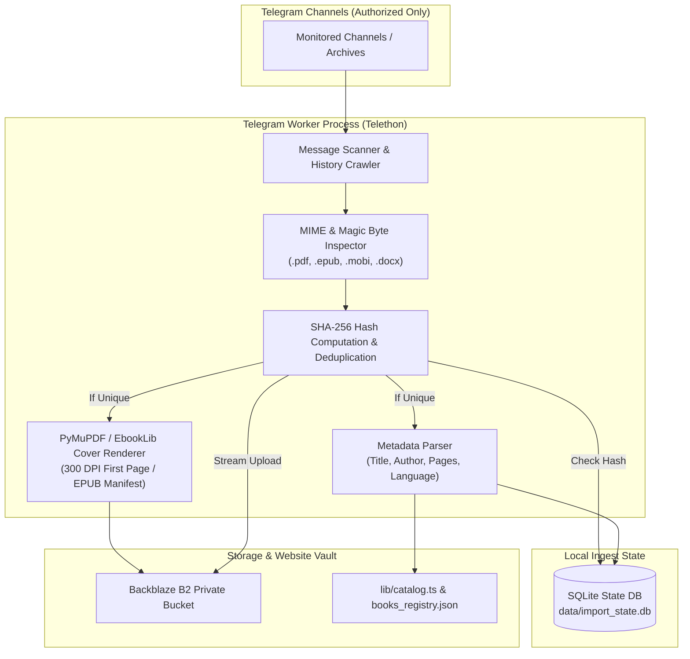

# AnonTrove — Telegram Archive Importer & Processing Pipeline

## 1. Overview & Operational Model

The Telegram Archive Importer (`workers/telegram_importer.py`) is an autonomous background processing worker designed to ingest ebooks from designated private channels, extract verified metadata and high-resolution cover artwork, deduplicate files, and upload content directly into the private Backblaze B2 object storage vault.

> [!IMPORTANT]
> **Zero Customer Exposure:** Telegram is purely an administrative ingest source. Telegram Bot links, MTProto sessions, or internal file IDs are never exposed to customers on the website. Customers download exclusively via authenticated, pre-signed Backblaze B2 download URLs.

---

## 2. Worker Architecture & Pipeline Flow



---

## 3. Worker Configuration & Environment Variables

The worker retrieves its configuration from `appinfo11.txt` or environment variables:

```env
# Telegram MTProto Credentials
TELEGRAM_API_ID=33519842
TELEGRAM_API_HASH=7d2da5e4ce8c7d61eb1aee99996bb3d5
TELEGRAM_PHONE=+919313271578
TELEGRAM_SESSION_NAME=anontrove_importer_session

# Ingest Channels (Comma-separated channel usernames or numerical IDs)
TELEGRAM_TARGET_CHANNELS=-1001234567890,EbooksPremiumVault

# Processing Limits
INGEST_MAX_FILE_SIZE_MB=500
INGEST_BATCH_SIZE=50
INGEST_RATE_LIMIT_DELAY_SECONDS=3.0
```

---

## 4. Extraction & Validation Rules

1. **Strict Format Whitelist:**
   - Allowed extensions: `.pdf`, `.epub`, `.mobi`, `.cbz`, `.docx`.
   - Magic byte verification:
     - PDF: Must start with `%PDF-`
     - EPUB / DOCX: Must be a valid ZIP container with an `mimetype` or `[Content_Types].xml` entry.
2. **Deduplication:**
   - Every file's SHA-256 hash is computed during streaming.
   - If the hash exists in `import_state.db`, the download is skipped and marked as duplicate, preventing redundant bandwidth and storage consumption.
3. **Cover Extraction:**
   - **PDF:** Render page 0 at 300 DPI using `fitz` (PyMuPDF), crop borders, and save as optimized JPEG.
   - **EPUB:** Extract cover image declared in `<item id="cover" ...>` or manifest item marked `properties="cover-image"`.
   - **Fallback:** If no embedded cover is found, generate a clean typographic placeholder with author and title using PIL (Pillow).

---

## 5. Execution & CLI Commands

To run the importer manually or as a background service:

```bash
# 1. Activate Python virtual environment
cd projects/anon-trove-ebooks
python -m venv venv
source venv/bin/activate  # On Windows: .\venv\Scripts\Activate.ps1

# 2. Run single scan of monitored channels
python workers/telegram_importer.py --mode scan --limit 50

# 3. Run in persistent daemon mode (watches for new posts continuously)
python workers/telegram_importer.py --mode daemon

# 4. Generate catalog delta report
python workers/telegram_importer.py --report
```
